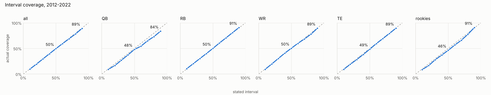
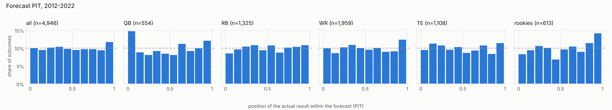
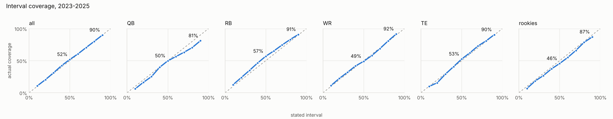
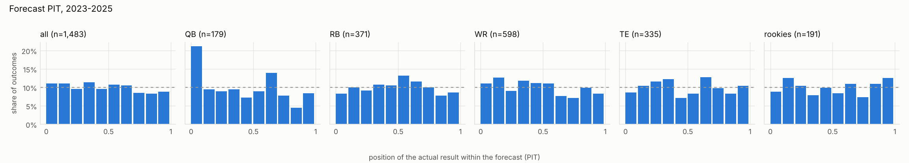

# Step 5 validation

**Result.** On the development seasons (2012–2022), DWAR passes the gate:
it beats all three baselines on both MAE and log score, overall and at every
position. On the held-out seasons (2023–2025, scored once, after every model
choice was made), it passes everywhere **except QB log score against the
3-year weighted average**, where it trails by 0.04 (bootstrap 90% interval
−0.12 to +0.04, so within noise). QB still beats that baseline on MAE, and
beats the other two on both measures.

Every season was fit as of the day before its first game, using only data
knowable then. Each fit then forecast that season's points per game (PPR).
Truth is each player-season with 4+ games, as of 2026-10-27. All methods are
scored on the same player-seasons. Players no fit knew (mostly undrafted
players with no NFL season yet) get no DWAR forecast and are left out of
every method alike: 512 in development, 92 in holdout.

## The model that was validated

| Position | Latent scale | Weeks fit | Forecast ranges |
| --- | --- | --- | --- |
| RB, WR, TE | `sqrt_hurdle` (as in step 4) | all | as fitted |
| QB | `sqrt_hurdle_log`: yearly drift proportional to level | weeks with 15+ plays (attempts + sacks + carries); short appearances added back in forecasts and DWAR | widened by a factor learned from earlier seasons only (1.17 for weekly runs) |

Every change here was chosen by ben from a decision card. Each was checked
on the development seasons before the held-out seasons were touched:

1. **Zero-week slope ≥ 0** (`h1 ~ HalfNormal(3)`, all positions). CLAUDE.md
   says the zero-week chance falls with talent, but the old prior allowed
   either sign, and one chain of the 2012 WR fit got stuck at −20.
2. **QB first run fails.** QB forecasts were too wide for established
   starters: drift of about ±4.5 PPG a year at a starter's level. The
   3-year weighted average beat DWAR at QB.
3. **Proportional drift + dropping short QB weeks, all positions.** QB MAE
   improved a lot, but TE log score got worse, and backups were
   over-forecast because their short games were dropped from the forecast too.
4. **Proportional drift for QB only + short appearances in the forecast.**
   QB beat every baseline on MAE (3.27 vs 3.39), but its ranges were now too
   narrow (90% range caught 78%).
5. **Heavy-tailed yearly QB steps.** Tried and reverted. The tail parameter
   stayed at its prior, scores barely moved, and fits became unstable.
6. **Point-in-time spread factor for QB.** The forecast spread is stretched
   by the root mean square of past standardized misses. With this, the
   development gate passed.

Every fit behind the numbers below passed the quality gate (0 divergences,
R-hat ≤ 1.01, ESS ≥ 400). One needed its automatic retry with doubled draws
(2014 RB). No fit was dropped.

## Accuracy vs baselines

MAE is in PPG, weighted by games played (lower is better). Log score is the
mean log predictive density (higher is better). "Beats all" requires DWAR to
be better than each baseline on both.

### Development, 2012–2022

| Group | n | DWAR MAE | Last season | 3-yr weighted | Age-adjusted | DWAR log score | Best baseline | Beats all |
| --- | ---: | ---: | ---: | ---: | ---: | ---: | ---: | :---: |
| All | 4,946 | **2.69** | 2.92 | 2.81 | 2.88 | **−2.56** | −2.73 | yes |
| QB | 554 | **3.27** | 3.71 | 3.39 | 3.71 | **−2.99** | −3.00 | yes |
| RB | 1,325 | **3.08** | 3.29 | 3.15 | 3.30 | **−2.62** | −2.84 | yes |
| WR | 1,959 | **2.72** | 2.95 | 2.87 | 2.86 | **−2.55** | −2.72 | yes |
| TE | 1,108 | **1.96** | 2.11 | 2.08 | 2.11 | **−2.29** | −2.45 | yes |
| Rookies (not gated) | 613 | **2.98** | 3.11 | 3.11 | 3.11 | **−2.59** | −2.76 | yes |

### Held out, 2023–2025 (scored once)

| Group | n | DWAR MAE | Last season | 3-yr weighted | Age-adjusted | DWAR log score | Best baseline | Beats all |
| --- | ---: | ---: | ---: | ---: | ---: | ---: | ---: | :---: |
| All | 1,483 | **2.47** | 2.72 | 2.65 | 2.69 | **−2.46** | −2.67 | yes |
| QB | 179 | **3.46** | 4.17 | 3.52 | 4.23 | −3.07 | **−3.03** | **no** |
| RB | 371 | **2.61** | 2.80 | 2.78 | 2.79 | **−2.62** | −2.75 | yes |
| WR | 598 | **2.54** | 2.80 | 2.79 | 2.74 | **−2.40** | −2.65 | yes |
| TE | 335 | **1.80** | 1.91 | 1.91 | 1.88 | **−2.07** | −2.34 | yes |
| Rookies (not gated) | 191 | **2.99** | 3.12 | 3.12 | 3.12 | **−2.61** | −2.77 | yes |

### Gain over the 3-year weighted average (the strongest baseline)

Positive means DWAR is better. The bootstrap 90% interval is over player-seasons.

| Group | Dev MAE gain | Dev log score gain | Holdout MAE gain | Holdout log score gain |
| --- | --- | --- | --- | --- |
| All | +0.12 (+0.09, +0.15) | +0.16 (+0.12, +0.20) | +0.18 (+0.12, +0.23) | +0.20 (+0.10, +0.28) |
| QB | +0.12 (−0.01, +0.25) | +0.01 (−0.05, +0.07) | +0.06 (−0.16, +0.26) | −0.04 (−0.12, +0.04) |
| RB | +0.07 (−0.01, +0.15) | +0.23 (+0.19, +0.26) | +0.17 (+0.06, +0.28) | +0.14 (−0.25, +0.37) |
| WR | +0.15 (+0.10, +0.20) | +0.17 (+0.14, +0.20) | +0.25 (+0.16, +0.34) | +0.27 (+0.22, +0.31) |
| TE | +0.12 (+0.07, +0.17) | +0.16 (−0.01, +0.30) | +0.11 (+0.03, +0.18) | +0.30 (+0.12, +0.43) |

At QB, DWAR and the 3-year weighted average are statistically tied on both
measures in both periods. Everywhere else DWAR's lead is clear.

## Calibration

| Group | Dev 50% / 90% coverage | Holdout 50% / 90% coverage |
| --- | --- | --- |
| All | 49.6% / 89.1% | 51.9% / 89.9% |
| QB | 48.0% / 83.6% | 49.7% / 81.0% |
| RB | 50.0% / 90.7% | 56.9% / 90.8% |
| WR | 50.3% / 89.4% | 49.0% / 91.6% |
| TE | 48.6% / 89.4% | 52.5% / 90.4% |
| Rookies | 46.3% / 90.7% | 45.5% / 86.9% |

Development:

Held out:

QB tails remain too thin even after widening. In the holdout, 21% of QB
outcomes fell in the bottom tenth of their forecast, against 10% if
calibrated. These are QBs who fell well short of their forecast: benched,
injured, or a bad new situation.

## Availability and survival (not gated)

Survival is the chance that a player who played in season s−1 plays in
season s. Games are forecast for players who did play. Both models are
compared with the position's base rate.

| Group | Survival Brier (dev / holdout) | Base rate | Games MAE (dev / holdout) | Base rate | Games 50% / 90% coverage (holdout) |
| --- | --- | --- | --- | --- | --- |
| All | 0.168 / 0.156 | 0.193 / 0.187 | 4.02 / 4.13 | 4.51 / 4.66 | 47% / 92% |
| QB | 0.149 / 0.128 | 0.181 / 0.171 | 3.64 / 3.95 | 5.31 / 4.91 | 56% / 95% |
| RB | 0.174 / 0.177 | 0.194 / 0.198 | 4.05 / 4.40 | 4.32 / 4.85 | 45% / 88% |
| WR | 0.166 / 0.156 | 0.195 / 0.194 | 3.92 / 3.86 | 4.33 / 4.47 | 49% / 94% |
| TE | 0.175 / 0.149 | 0.195 / 0.172 | 4.40 / 4.37 | 4.58 / 4.61 | 38% / 93% |

Both models beat base rates everywhere. Games intervals are a bit narrow at
the center for TE.

## Open items

- **QB.** It ties the best simple baseline instead of beating it, and its
  tails are too thin. The likely missing inputs are the situation factors
  ben asked for (new team, coaching, line, target competition). These are
  the planned next step.
- **QB spread factor.** It is a stopgap, set in `config/value.yaml` from the
  backtest (1.17 from development; it reached 1.23 by 2025). It should shrink
  as situation factors are added. Re-derive it whenever the backtest reruns.
- **Superflex QB replacement level** (step 4 note) still needs revisiting
  against market values in step 7.

Raw numbers are in `dev/summary.json` and `holdout/summary.json`.
