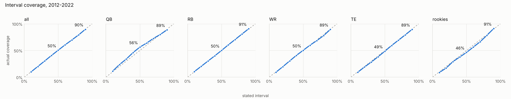
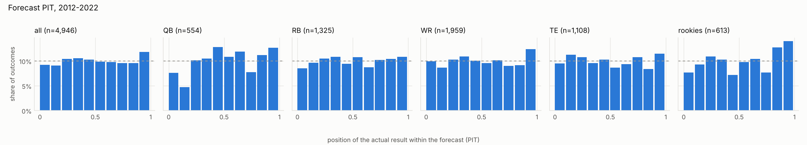

# Step 5 validation: development seasons 2012–2022

**Result: fails the gate at QB. DWAR passes overall and at RB, WR, and TE.**
The held-out seasons (2023–2025) have **not** been scored. They stay untouched
until the QB fix is decided, so they remain a clean final check.

Every season was fit as of the day before its first game, using only data
knowable then, and then forecast that season's points per game (PPR). Truth
is each player-season with 4+ games, as of 2026-10-27. All four methods are
scored on the same 4,946 player-seasons. 512 more had no DWAR forecast, because
no fit knew the player (mostly undrafted players with no prior NFL season), and
are left out of every method alike.

## Fits

All 44 position-season fits (11 seasons × 4 positions) passed the quality gate
(0 divergences, R-hat ≤ 1.01, ESS ≥ 400). One needed its automatic retry with
doubled tune/draws: **2014 RB** (first try R-hat 1.0102 at `alpha_undrafted`).
No fit was dropped.

One model change was made during this step (approved by ben, 2026-10-27):
the zero-week slope `h1` is now `HalfNormal(3)`, so a zero week can only get
rarer as talent rises, as CLAUDE.md specifies. Before this, one chain of the
2012 WR fit got stuck in a nonsense solution (slope −20) and the fit failed
twice. With the change, the good chains' estimates were unchanged and the fit
passed.

## Accuracy vs baselines

MAE is in PPG, weighted by games played (lower is better). Log score is the mean
log predictive density (higher is better). "Beats" requires DWAR to be better on
both.

| Group | n | DWAR MAE | Last season | 3-yr weighted | Age-adjusted | DWAR log score | Best baseline log score | Beats all |
| --- | ---: | ---: | ---: | ---: | ---: | ---: | ---: | :---: |
| All | 4,946 | **2.72** | 2.92 | 2.81 | 2.88 | **−2.58** | −2.73 | yes |
| QB | 554 | 3.54 | 3.71 | **3.39** | 3.71 | −3.13 | **−3.00** | **no** |
| RB | 1,325 | **3.08** | 3.29 | 3.15 | 3.30 | **−2.62** | −2.84 | yes |
| WR | 1,959 | **2.72** | 2.95 | 2.87 | 2.86 | **−2.55** | −2.72 | yes |
| TE | 1,108 | **1.96** | 2.11 | 2.08 | 2.11 | **−2.29** | −2.45 | yes |
| Rookies (not gated) | 613 | **3.03** | 3.11 | 3.11 | 3.11 | **−2.60** | −2.76 | yes |

DWAR's gain over the 3-year weighted baseline, with bootstrap 90% intervals
(positive means DWAR is better):

| Group | MAE gain | Log score gain |
| --- | --- | --- |
| All | +0.09 (+0.06 to +0.12) | +0.15 (+0.11 to +0.19) |
| QB | **−0.15 (−0.27 to −0.03)** | **−0.12 (−0.18 to −0.06)** |
| RB | +0.07 (−0.01 to +0.15) | +0.23 (+0.19 to +0.26) |
| WR | +0.15 (+0.10 to +0.20) | +0.17 (+0.14 to +0.20) |
| TE | +0.12 (+0.07 to +0.17) | +0.16 (−0.01 to +0.30) |

At QB, DWAR beats the last-season and age-adjusted baselines on MAE (by about
0.17 PPG). It loses to all three on log score, and loses to the 3-year weighted
average on both measures.

## Calibration

| Group | 50% interval covers | 90% interval covers |
| --- | ---: | ---: |
| All | 50.5% | 89.6% |
| QB | 56.3% | 88.6% |
| RB | 50.0% | 90.7% |
| WR | 50.3% | 89.4% |
| TE | 48.6% | 89.4% |
| Rookies | 46.3% | 91.0% |

Overall and at RB, WR, and TE, calibration is close to ideal. At QB the center
of the forecast is too wide (56% inside the 50% interval) while the tails are
about right, so the shape is off rather than just the scale.

## Why QB fails

For QBs with 14+ games, the forecast spread is too wide. DWAR's predictive SD
averages 5.3 PPG, against 4.3 for the weighted baseline. Only 0.4% of these
outcomes fall in DWAR's bottom 5%, and DWAR also under-forecasts them by
0.9 PPG on average. The talent random walk is the likely cause. Its yearly step
is on the square-root scale (QB `tau` = 0.54 in the 2022 fit), so at a typical
starter's level (about 18 PPG) one step is about ±4.5 PPG a year. That is much
more drift than established starters actually show. QBs sit higher on the
scale than other positions, so this hits them hardest. Partial games may also
inflate the step size: injury exits, mop-up relief, and kneel-downs all look
like real low-scoring weeks.

## Availability and survival (not gated)

Survival is the chance that a player who played in season s−1 plays in season s.
Games are forecast for players who did play.

| Group | Survival Brier | Base-rate Brier | Games MAE | Base-rate MAE | Games 50% / 90% coverage |
| --- | ---: | ---: | ---: | ---: | --- |
| All | 0.170 | 0.193 | 3.98 | 4.51 | 45% / 91% |
| QB | 0.160 | 0.181 | 3.33 | 5.31 | 53% / 95% |
| RB | 0.174 | 0.194 | 4.05 | 4.32 | 46% / 91% |
| WR | 0.166 | 0.195 | 3.92 | 4.33 | 45% / 92% |
| TE | 0.175 | 0.195 | 4.40 | 4.58 | 40% / 88% |

Both models beat base rates at every position. Survival is well calibrated
above 50% forecast probability. Below that, players survived more often than
forecast (51% observed vs 41% forecast, n = 728). The games intervals are
slightly too narrow at TE.

## Proposed fixes for QB (not made)

1. **Make the yearly talent step proportional to level.** Put the step on the log
   scale, or scale `tau` with the current level. A ±10% step means about ±1.8
   PPG for an 18-PPG QB instead of ±4.5. This targets the main symptom and
   applies to every position, so all four would be refit and rechecked.
2. **Drop partial QB games.** Remove weeks where the QB played under a threshold
   share of snaps. Snap counts start in 2013, so earlier seasons would need a
   fallback (pass attempts).
3. **Exempt QB from the gate.** Ship with QB reported only. This is not
   recommended, because superflex values lean heavily on QBs.

Raw numbers are in `summary.json` next to this file.
