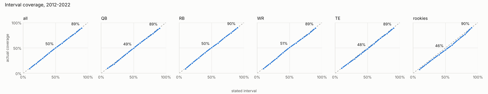
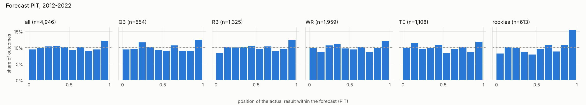
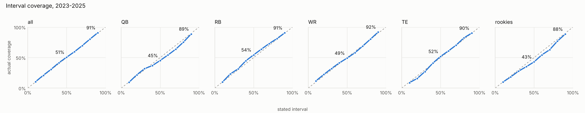
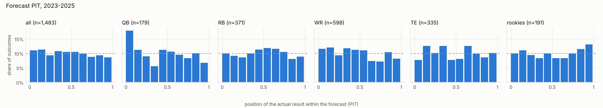

# Situation factors

**Result.** Two situation factors earned a place, and with them QB now
clearly beats every baseline, on the development seasons and on the
held-out seasons. The model passes the gate everywhere in both periods.

- **QB: QB1 on the preseason depth chart.** It shifts the QB's expected
  scoring a little, and it sets his chance of a short appearance (under 15
  plays): about 3% a game for a preseason QB1 against 42% for anyone else.
  Most QB forecasts that missed low in step 5 were starters who lost the
  job and spent the season in short relief appearances.
- **RB: target and carry competition.** This counts the opportunity of RBs
  returning on the preseason roster, the share of last season's RB work that
  left, and RBs the team drafted in rounds 1 to 3.

Nothing else cleared the bar. That includes the play-caller factors ben
asked about: play-caller pass tendency, pace, and a new-play-caller flag.
They made RB and WR forecasts slightly *worse*. The yearly-volatility
("range") factors were also dropped: changed team, new play-caller and new
QB. The QB spread factor is still needed, at 1.34. The hinge QB age curve
was no better than the quadratic.

The approved plan is in the [situation factors plan doc](https://claude.ai/artifact/DGJbwm72CndB779ucWzHRv).
Scoring now floors every method's predictive density (chosen by ben,
2026-10-30). Each forecast keeps 1% of its probability spread evenly over
0 to 40 PPG, so a few freak breakouts can't outweigh everything else. The
step 5 numbers below are re-scored the same way, on the data as of
2026-10-29.

## How each factor is measured

Every factor for player-season (i, s) is what was knowable the day before
season s's first game, both when fitting past seasons and when forecasting.
This is tested in `tests/features/test_situation.py`: deleting or
corrupting everything after that date changes nothing. Sources are
nflverse play-by-play, weekly rosters and depth charts (all via
nflreadpy), and Sam Hoppen's public
[play-caller table](https://github.com/samhoppen/NFL_public). That table
has the offensive play-caller for every team-game since 1999. It has no
license file, so it is cached locally and never committed.

| Group | Factor | Positions | Kept |
| --- | --- | --- | --- |
| QB | QB1 on the preseason depth chart | QB | **yes** |
| QB | Expected QB's EPA per dropback (3 seasons, shrunk to a draft-round prior) | RB, WR, TE | no |
| Coaching | Play-caller's pass rate over expected (his last 3 seasons, any team) | all | no |
| Coaching | Team offensive pace | all | no |
| Coaching | New play-caller (range) | all | no |
| Competition | Returning competition, vacated opportunity, drafted rookies | RB | **yes** |
| Competition | The same | WR, TE | no |
| Competition | Top-3 pass catchers' PPG on the roster ("weapons") | QB | no |
| Stability | Changed team, new QB1, team drafted a round-1 QB (range) | all | no |

Range factors were a new model slot. Each 0/1 flag scales that season's
random-walk step by exp(kappa). The slot works: a parameter-recovery test
gets a true kappa of 0.7 back. On real data, though, no flag helped
forecasts, so none is turned on. The slot stays in the code at no cost.

## Which factors stayed (runs B)

Each group was removed in turn from the all-factor model (run A) and
backtested on 2012, 2014, ..., 2022. The table shows run A minus the run
without that group. Positive means the group helps, and the 90% bootstrap
interval is in brackets. A group stayed at a position when removing it made
MAE or the floored log score clearly worse and neither clearly better.

| Group | QB | RB | WR | TE |
| --- | --- | --- | --- | --- |
| QB | MAE +0.024 [+0.010, +0.038], LS +0.020 [+0.001, +0.040] **keep** | MAE +0.001, LS −0.002 | MAE +0.001, LS +0.000 | MAE +0.001, LS −0.001 |
| Coaching | MAE −0.028 [−0.060, +0.003], LS +0.009 | MAE **−0.017** [−0.032, −0.004] | MAE **−0.020** [−0.034, −0.006] | MAE +0.010, LS −0.009 |
| Competition | MAE −0.001, LS +0.018 [−0.002, +0.038] | MAE +0.025, LS +0.025 [+0.008, +0.040] **keep** | MAE +0.015, LS +0.009 [−0.000, +0.018] | MAE −0.003, LS +0.008 |
| Stability | MAE −0.003, LS +0.005 | MAE **−0.014** [−0.026, −0.001] | MAE +0.003, LS +0.005 | MAE +0.002, LS +0.001 |

WR competition and QB weapons came close and could be retested with more
seasons. Run C answered the remaining two questions. With the QB spread
factor off, QB 90% ranges caught only 79% of outcomes, so it stays at 1.34,
re-derived from the 2012–2025 backtest. A hinge age curve for QBs (flat or
rising to 30, then a straight decline) scored no better than the quadratic
(MAE −0.014, log score −0.007), so the quadratic stays.

## Final model vs the step 5 model

Paired on the same player-seasons. Positive means the final model is
better. Brackets give the 90% bootstrap interval.

| Group | Dev MAE gain | Dev log score gain | Holdout MAE gain | Holdout log score gain |
| --- | --- | --- | --- | --- |
| All | +0.019 [+0.002, +0.036] | +0.010 [+0.004, +0.016] | +0.013 [−0.014, +0.040] | +0.012 [+0.002, +0.022] |
| QB | +0.065 [−0.047, +0.184] | +0.042 [+0.006, +0.081] | +0.123 [−0.092, +0.325] | +0.096 [+0.030, +0.162] |
| RB | +0.042 [−0.007, +0.085] | +0.019 [+0.007, +0.032] | +0.014 [−0.047, +0.071] | +0.003 [−0.014, +0.022] |
| WR | +0.002 | +0.001 | −0.004 | +0.004 |
| TE | +0.001 | −0.003 | −0.005 | −0.009 [−0.018, −0.000] |

WR and TE use the same model as step 5. Their small differences are Monte
Carlo noise from the forecast simulation. QB misses in the bottom tenth of
the forecast fell from 13% to 9% on development seasons. In the holdout
they stayed at 18% for both models. QB lower tails are better but still not
fully fixed.

## Accuracy vs baselines

### Development, 2012–2022

| Group | n | DWAR MAE | Last season | 3-yr weighted | Age-adjusted | DWAR log score | Best baseline | Beats all | 50% / 90% coverage |
| --- | ---: | ---: | ---: | ---: | ---: | ---: | ---: | :---: | --- |
| All | 4,946 | **2.67** | 2.92 | 2.81 | 2.88 | **−2.51** | −2.73 | yes | 50.0% / 89.2% |
| QB | 554 | **3.20** | 3.71 | 3.39 | 3.71 | **−2.91** | −2.99 | yes | 49.5% / 88.8% |
| RB | 1,325 | **3.03** | 3.29 | 3.15 | 3.30 | **−2.60** | −2.84 | yes | 50.5% / 89.7% |
| WR | 1,959 | **2.72** | 2.95 | 2.87 | 2.86 | **−2.54** | −2.72 | yes | 50.8% / 89.2% |
| TE | 1,108 | **1.96** | 2.11 | 2.08 | 2.11 | **−2.15** | −2.45 | yes | 48.3% / 88.9% |
| Rookies (not gated) | 613 | **3.00** | 3.11 | 3.11 | 3.11 | **−2.61** | −2.76 | yes | 46.2% / 89.7% |

### Held out, 2023–2025

| Group | n | DWAR MAE | Last season | 3-yr weighted | Age-adjusted | DWAR log score | Best baseline | Beats all | 50% / 90% coverage |
| --- | ---: | ---: | ---: | ---: | ---: | ---: | ---: | :---: | --- |
| All | 1,483 | **2.45** | 2.72 | 2.65 | 2.69 | **−2.38** | −2.67 | yes | 50.6% / 90.8% |
| QB | 179 | **3.34** | 4.17 | 3.52 | 4.23 | **−2.93** | −3.02 | yes | 45.3% / 88.8% |
| RB | 371 | **2.59** | 2.80 | 2.78 | 2.79 | **−2.44** | −2.75 | yes | 54.4% / 90.6% |
| WR | 598 | **2.53** | 2.80 | 2.79 | 2.74 | **−2.40** | −2.65 | yes | 49.2% / 92.0% |
| TE | 335 | **1.81** | 1.91 | 1.91 | 1.88 | **−2.00** | −2.35 | yes | 51.9% / 90.1% |
| Rookies (not gated) | 191 | **3.00** | 3.12 | 3.12 | 3.12 | **−2.59** | −2.77 | yes | 42.9% / 88.5% |

On the same scoring, the step 5 model *fails* the holdout at QB: its log
score trails the 3-year weighted average by 0.006. The final model leads it
by 0.09 (interval +0.01 to +0.16).

### Gain over the 3-year weighted average

| Group | Dev MAE gain | Dev log score gain | Holdout MAE gain | Holdout log score gain |
| --- | --- | --- | --- | --- |
| All | +0.14 (+0.10, +0.17) | +0.22 (+0.20, +0.23) | +0.19 (+0.14, +0.25) | +0.28 (+0.26, +0.31) |
| QB | +0.18 (+0.03, +0.34) | +0.08 (+0.04, +0.13) | +0.18 (−0.12, +0.46) | +0.09 (+0.01, +0.16) |
| RB | +0.12 (+0.04, +0.21) | +0.24 (+0.21, +0.28) | +0.19 (+0.06, +0.31) | +0.32 (+0.26, +0.39) |
| WR | +0.15 (+0.10, +0.20) | +0.19 (+0.16, +0.21) | +0.26 (+0.17, +0.35) | +0.27 (+0.23, +0.31) |
| TE | +0.12 (+0.07, +0.17) | +0.30 (+0.27, +0.33) | +0.10 (+0.02, +0.17) | +0.37 (+0.31, +0.43) |

### 2026 so far (not gated)

The 2026 season was fit as of 2026-09-08 and scored on weeks 1 to 8 for
players with 4+ games (392 player-seasons). No choice was made on it. The
final model beats every baseline on log score at every position. On MAE it
trails last season's PPG at WR (2.69 vs 2.65) and the 3-year average at TE
(1.68 vs 1.66), both within noise for half a season. Ranges are a little
wide so far (90% ranges caught 95%). Against the step 5 model on the same
players, QB MAE is better by 0.45 PPG (interval +0.04 to +0.87, 33 QBs),
and overall by 0.05 (+0.01 to +0.09).

## Calibration

Development:




Held out:




## Reproducing

Each run is defined in `src/dwar/validate/experiments.py`:

```
uv run python -m dwar.validate.experiments F                         # 2012-2022
uv run python -m dwar.validate.experiments F 2023,2024,2025 holdout
uv run python -m dwar.validate.compare_runs F step5                  # paired comparison
```

Each fit takes about 1 GB on disk. Delete a finished run's `.nc` files
before starting the next one.
